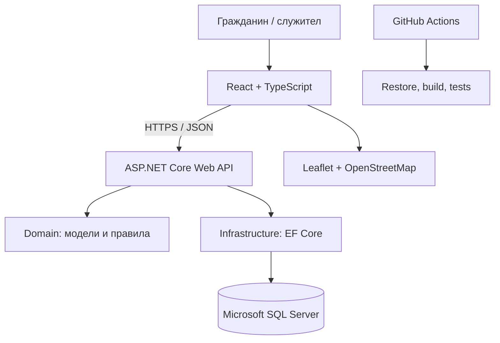

# Архитектура — UrbanSignals

## Архитектурен подход
Планира се многослойна архитектура с ясно разделение между потребителския интерфейс, HTTP API, бизнес логиката и достъпа до данни.

## Компоненти
- **Frontend:** React + TypeScript, форми, карта, списък, детайли на сигнал и служебно табло. В момента интерфейсът е прототип с примерни данни.
- **API:** ASP.NET Core Web API, маршрути, HTTP статуси, обработка на заявките и валидация.
- **Domain:** Entities, enums и независими от базата правила на работния процес.
- **Infrastructure:** EF Core DbContext, SQL Server конфигурация, миграции и начални данни.
- **Tests:** xUnit тестове за правила и бизнес логика.
- **CI:** GitHub Actions workflow, който възстановява NuGet/npm зависимостите и изпълнява build/test проверките.

## Планирани контролери
1. `ReportsController` — списък, детайли и операции по сигналите.
2. `CategoriesController` — категории на проблемите.
3. `AssignmentsController` — назначаване и работа по задачи.
4. `CommentsController` — коментари и актуализации.
5. `AdminController` — административна статистика и управление.

Това е проектен план. Служебните и административните крайни точки трябва да бъдат защитени чрез ролево-базирана авторизация преди публично внедряване.

## Проектни шаблони
Планира се използване на **Service Layer** за отделяне на бизнес правилата от HTTP контролерите. При необходимост може да се използва **Strategy Pattern** за оценка на дублирани сигнали или избор на срок за реакция според категорията и приоритета. Изборът ще бъде обоснован след уточняване на правилата, за да не се добавя шаблон само формално.

## Основни потоци
1. Гражданин изпраща форма за сигнал.
2. API валидира данните и записва сигнала и първоначалната история на статуса.
3. Операторът преглежда сигнала и назначава изпълнител.
4. Изпълнителят публикува напредък.
5. Промените се записват в историята и се показват в публичната страница на сигнала.
6. Известията се изпращат/показват на съответните потребители.
